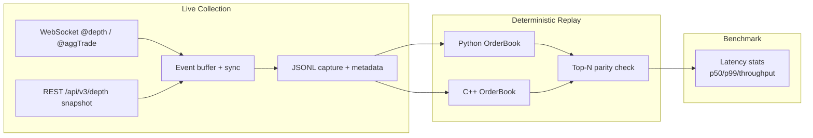

# Binance Market-Data Latency Benchmark

A verified, real-data latency benchmark for Binance Spot public market data. Measures order-book update and local processing latency using live WebSocket diff-depth streams and REST snapshots. Provides equivalent Python and C++ order-book engines with deterministic replay of captured events.

**Author:** Chrisler Nunes

## Features

- Live collection of Binance Spot `@depth` (diff) and optional `@aggTrade` streams plus REST depth snapshots
- Correct snapshot-plus-diff synchronization following official Binance procedure
- Normalized JSONL capture format with local monotonic timestamps, exchange timestamps, and sequence IDs
- Deterministic replay into Python and C++ order-book engines
- Precise local processing latency (decode, update, top-N, end-to-end) using monotonic clocks
- Application receive-to-processing latency (not exchange-to-client)
- Percentile statistics, throughput, sequence-gap detection, and parity checks
- No synthetic data in primary benchmark paths
- No API keys or trading permissions required

## Architecture



## Data Source

- **WebSocket streams:** `wss://stream.binance.com:9443/ws/<symbol>@depth` and `<symbol>@aggTrade`
- **REST snapshot:** `GET https://api.binance.com/api/v3/depth?symbol=<SYMBOL>&limit=5000`
- Official documentation:
  - [WebSocket Streams](https://developers.binance.com/docs/binance-spot-api-docs/web-socket-streams)
  - [REST API](https://developers.binance.com/docs/binance-spot-api-docs/rest-api)

### Level-2 Depth Semantics

Binance diff-depth delivers aggregated market-by-price updates. Each price level carries an absolute quantity:

- Positive quantity → insert or replace the level
- Zero quantity → remove the level
- Price and quantity are decimal strings; never use binary floating-point equality for keys

The stream is not individual order IDs, cancellations, or matching-engine actions. Aggregate trades are a separate event type.

## Synchronization Procedure

1. Open the diff-depth WebSocket and buffer events. Record the first `U`.
2. Fetch a REST depth snapshot (`lastUpdateId`).
3. Discard buffered events where `u <= lastUpdateId`.
4. The first applicable event must satisfy `U <= lastUpdateId + 1` and `u >= lastUpdateId + 1`.
5. Apply the snapshot, then subsequent events in order.
6. Each new event must have `U == previous_u + 1`; otherwise detect a gap, invalidate the book, and resynchronize.
7. On gap or disconnect, restart from a fresh snapshot.

## Installation

```bash
# Python 3.10+
python -m venv .venv
source .venv/bin/activate  # or .venv\Scripts\activate on Windows
pip install -r requirements.txt

# C++ (CMake 3.16+, C++17)
mkdir -p build && cd build
cmake -DCMAKE_BUILD_TYPE=Release ..
cmake --build . --config Release
```

## Usage

### Capture real market data

```bash
python -m src.python.cli capture --symbol BTCUSDT --duration 30 --output captures/btcusdt.jsonl
```

### Validate a capture

```bash
python -m src.python.cli validate --input captures/btcusdt.jsonl
```

### Replay and benchmark

```bash
# Python
python -m src.python.cli replay --input captures/btcusdt.jsonl --engine python

# C++ (after build)
./build/binance_md_benchmark replay --input captures/btcusdt.jsonl

# Correctness parity
python -m src.python.cli compare --input captures/btcusdt.jsonl
```

### Unit tests

```bash
pytest tests/ -v
```

### Optional live connectivity check

```bash
python -m src.python.cli connectivity --symbol BTCUSDT --timeout 10
```

## Capture Format

JSONL (one JSON object per line). Versioned header line followed by events:

```json
{"type":"header","version":1,"symbol":"BTCUSDT","market":"spot","start_ts_ns":...}
{"type":"snapshot","last_update_id":123456,"bids":[["price","qty"],...],"asks":[...],"local_recv_ns":...}
{"type":"depth","U":123457,"u":123460,"b":[["price","qty"],...],"a":[...],"E":...,"local_recv_ns":...}
{"type":"agg_trade",...}
```

Hashes and metadata allow results to be tied to the exact input file.

## Latency Metrics

| Metric | Definition | Clock domain |
|--------|------------|--------------|
| Local processing | Start of processing a normalized event → completion of update + top-N | Monotonic (`perf_counter_ns` / `steady_clock`) |
| Receive-to-processing | Application WebSocket receive timestamp → processing finish | Local monotonic |
| Exchange event time | Binance `E` field | Exchange clock (kept separate) |

No one-way network latency is claimed without clock synchronization. Artificial delays, if present, are explicitly simulated and labeled.

Statistics include sample count, min, mean, p50, p90, p95, p99, p99.9, max, throughput (events / wall-clock), and gap/invalid counts. Percentiles use linear interpolation.

## Correctness

Python and C++ engines share equivalent semantics. A parity test processes the same capture and compares top-N bids/asks after every event (or at checkpoints). Edge cases cover zero-quantity deletion, empty sides, sequence gaps, and malformed data.

## Reproducibility

All benchmark numbers come from real captured files. Capture metadata and content hashes are recorded with results. Re-run any capture with the same CLI flags for new data.

## Limitations

- Measures application-level processing and receive-to-processing latency, not exchange matching-engine, NIC, or kernel latency.
- Snapshot limit is 5000 levels; levels outside the snapshot are only known when they update.
- Requires network access for live capture and the optional connectivity test.
- No order placement or private endpoints.

## License

MIT License. See [LICENSE](LICENSE).
