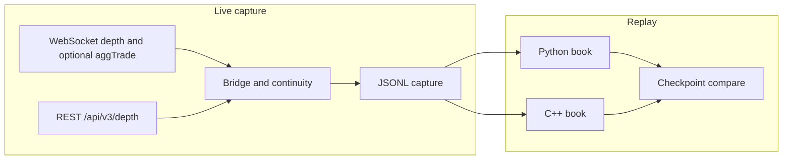

# Binance Market-Data Latency Benchmark

Capture public Binance Spot diff-depth, replay it through Python and C++ order books, and measure local processing latency. The collector uses public market data only. It does not place orders or use an API key.

**Author:** Chrisler Nunes

## What it does

- Opens the public diff-depth WebSocket, buffers events, and bridges a REST depth snapshot using the current Spot procedure.
- Writes a versioned JSONL capture. Aggregate trades stay a separate event type and do not change the book.
- Replays that capture through a Python book and a C++ book with the same absolute-quantity rules.
- Reports separate timers for decode, snapshot apply, depth apply, top-N extraction, and wall-clock throughput.

No verified live benchmark numbers are included. A network that cannot reach Binance, including HTTP 451, fails the capture and the connectivity command. Nothing is invented in its place.

## Architecture



One task owns the WebSocket read. The local monotonic timestamp is taken when the socket returns a message, before JSON parsing. REST runs while that reader keeps filling a bounded queue.

## Data source

- Combined or raw stream: `wss://stream.binance.com:9443`
- Depth: `<symbol>@depth` (1000 ms) or `<symbol>@depth@100ms`
- Trades, only with `--trades`: `<symbol>@aggTrade` on the combined stream `wss://stream.binance.com:9443/stream?streams=...`
- Snapshot: `GET https://api.binance.com/api/v3/depth?symbol=SYMBOL&limit=N` (`N` from 1 to 5000)

Documentation:

- [WebSocket Streams](https://github.com/binance/binance-spot-api-docs/blob/master/web-socket-streams.md)
- [REST API](https://github.com/binance/binance-spot-api-docs/blob/master/rest-api.md)

### Level-2 absolute quantities

Each bid or ask in a depth event is the new quantity at that price. A positive quantity inserts or replaces the level. A zero quantity removes it, including `0`, `0.0`, and `0.00000000`. This is not an order-by-order feed: there are no individual order ids, cancels, or matching-engine events to reconstruct. Prices and quantities are decimal strings. The engines canonicalize them and never use binary floating-point equality.

### Synchronization

1. Buffer depth events and remember the `U` of the first one.
2. Fetch a REST snapshot.
3. If `lastUpdateId` is strictly less than that first `U`, fetch another snapshot.
4. Drop buffered depth events with `u <= lastUpdateId`.
5. The first remaining depth event must have `U <= lastUpdateId + 1`. That covers an overlapping range and the contiguous case `U == lastUpdateId + 1`. A larger `U` is a gap: the buffer is discarded and synchronization restarts.
6. After the book is live, `u < last_update_id` is ignored as obsolete. `U > last_update_id + 1` invalidates the book. Otherwise the event is applied, including an overlap, and the stored id becomes `u`.
7. A gap writes the offending event, clears the book, and starts again from a new snapshot so replay can recover the same way.
8. The queue and the buffer are bounded. Overflow aborts the capture. Events are not dropped silently.
9. A capture file is published only if the book is synchronized at the end. Failure deletes the partial file.

A REST snapshot has at most 5000 levels per side. Levels outside that snapshot stay unknown until an event updates them.

## Requirements

- Python 3.10+
- CMake 3.16+ and a C++17 compiler
- nlohmann/json 3.11.3, vendored at `third_party/nlohmann/json.hpp` (MIT). A clean build does not need a system copy.

## Install and build

```bash
python -m venv .venv
source .venv/bin/activate
pip install -r requirements.txt

cmake -S . -B build -DCMAKE_BUILD_TYPE=Release
cmake --build build
./build/orderbook_tests
```

The commands above are what CI runs on Ubuntu. This repository is tested on Linux.

## Commands

```bash
python -m src.python.cli capture --symbol BTCUSDT --duration 30 --output captures/btcusdt.jsonl
python -m src.python.cli capture --symbol BTCUSDT --duration 30 --output captures/btcusdt.jsonl --trades --depth-ms 100 --snapshot-limit 1000 --max-events 1000
python -m src.python.cli validate --input captures/btcusdt.jsonl
python -m src.python.cli replay --input captures/btcusdt.jsonl --engine python
./build/binance_md_benchmark replay --input captures/btcusdt.jsonl
python -m src.python.cli replay --input captures/btcusdt.jsonl --engine cpp --cpp-bin ./build/binance_md_benchmark
python -m src.python.cli compare --input tests/fixtures/parity.jsonl --cpp-bin ./build/binance_md_benchmark
python -m src.python.cli connectivity --symbol BTCUSDT --timeout 10
python -m pytest -q
```

`--duration` is required for capture. `--engine` is required for replay and must be `python` or `cpp`. A missing binary, a missing file, HTTP 451, or an unsupported schema exits non-zero. `compare` exits 0 when the engines produce the same counts, final top of book, and checkpoints, including when both end unsynchronized. Replay itself exits 3 when the book does not end synchronized or a record was malformed. Validate exits 3 for a readable capture that does not end synchronized, and exits 1 for a bad checksum or schema error.

## JSONL schema

Version 1. One JSON object per line. The footer `content_sha256` covers every preceding line, including the trailing newline.

```json
{"type":"header","version":1,"symbol":"BTCUSDT","market":"spot","depth_stream":"btcusdt@depth","include_trades":false,"snapshot_limit":5000,"clock":"perf_counter_ns"}
{"type":"snapshot","last_update_id":100,"bids":[["100.00","1.50"]],"asks":[["101.0","1"]],"local_recv_ns":1,"reason":"initial","local_applied_ns":2}
{"type":"depth","U":100,"u":104,"b":[["100","2.0"]],"a":[],"E":1,"local_recv_ns":3,"local_applied_ns":4}
{"type":"agg_trade","a":7,"p":"100.1","q":"0.01","E":3,"T":3,"m":false,"local_recv_ns":5}
{"type":"footer","version":1,"status":"complete","records":3,"resyncs":0,"content_sha256":"..."}
```

`local_recv_ns` and `local_applied_ns` are `time.perf_counter_ns` values from the capture process. Their difference is the collector delay from socket return until the book decision, and for buffered events that includes waiting for the snapshot. It is not one-way network latency and it is not replay processing time. Replay does not subtract these values, and it does not subtract Binance's `E` timestamp from a local clock.

`tests/fixtures/parity.jsonl` and `tests/fixtures/gap.jsonl` are deterministic fixtures for tests. They are not market measurements.

## Latency and throughput

All replay timers use a monotonic clock (`time.perf_counter_ns` in Python, `std::chrono::steady_clock` in C++).

| Field | Starts | Stops | Included |
| --- | --- | --- | --- |
| `decode_ns` | before `parse` of one record | after the record validates | JSON parse and field checks only |
| `snapshot_update_ns` | call to apply a snapshot | return | successful snapshot apply only |
| `depth_update_ns` | call to apply a depth event | return | successful depth applies only |
| `topn_ns` | call to `top_n` | return | after a successful snapshot or depth apply |
| `event_processing_ns` | decode start of that record | end of its top-N | decode + update + top-N for successful book updates |
| `elapsed_ns` | before the replay loop | after the last line | file reads, rejects, and everything else in the loop |
| `throughput_events_per_s` | — | — | successful snapshot and depth applies divided by `elapsed_ns` in seconds |

Stale events, gaps, malformed records, and aggregate trades are counted separately and are not mixed into the depth-update sample. Snapshot samples are not mixed into depth samples. Throughput is not the reciprocal of mean service time. No outliers are removed.

Percentiles use linear interpolation: `rank = (pct / 100) * (n - 1)` on the sorted sample, with `pct` in `[0, 100]`. An empty sample has count 0 and null percentile fields. Both engines use this definition.

The report does not measure NIC, kernel, FPGA, matching-engine, or one-way network latency.

## Correctness

`compare` checks snapshot count, applied depth count, stale ignores, gaps, invalid records, unsynchronized rejects, aggregate-trade count, synchronization, final top-N, and the checkpoint after every snapshot and depth record. Top-N prices are canonical decimals in numeric order, so `100`, `20`, and `9` sort numerically rather than lexicographically. `99.50` and `99.5` are one level.

```bash
python -m pytest -q
cmake -S . -B build -DCMAKE_BUILD_TYPE=Release && cmake --build build
./build/orderbook_tests
python -m src.python.cli compare --input tests/fixtures/parity.jsonl --cpp-bin ./build/binance_md_benchmark
```

CI in `.github/workflows/ci.yml` runs those steps. It does not call Binance.

## Reproducible benchmark

1. Capture on a network that can reach Binance and keep the JSONL file.
2. Validate it.
3. Replay it with `--engine python` and `--engine cpp`.
4. Keep the JSON reports with the capture. The footer hash identifies the body.

There is no result table in this repository because no live capture has been verified here.

## Layout

```text
src/python/    collector, sync, order book, replay, CLI
src/cpp/       decimal keys, order book, JSONL replay
tests/         unit tests and deterministic fixtures
third_party/   nlohmann/json 3.11.3
```

## Limitations

- Application processing and collector queue delay only.
- Snapshot depth is capped at 5000 levels per side.
- Live capture depends on Binance being reachable. HTTP 451 is a hard failure.
- `local_recv_ns` cannot be compared across processes.
- Python stores levels in dictionaries and sorts for top-N. C++ uses ordered maps with a decimal comparator. Same results, different structures, so the timings are for these two implementations.

## License

MIT. See [LICENSE](LICENSE). Copyright (c) 2026 Chrisler Nunes.

`third_party/nlohmann/json.hpp` is nlohmann/json 3.11.3, also MIT, copyright Niels Lohmann. See `third_party/nlohmann/README.md`.
